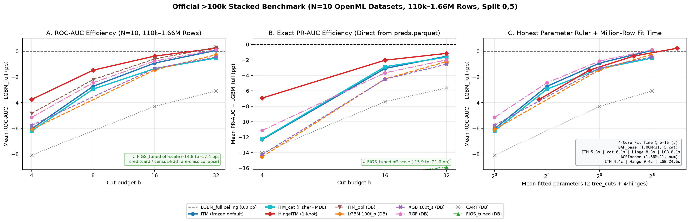
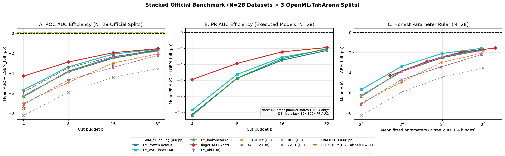
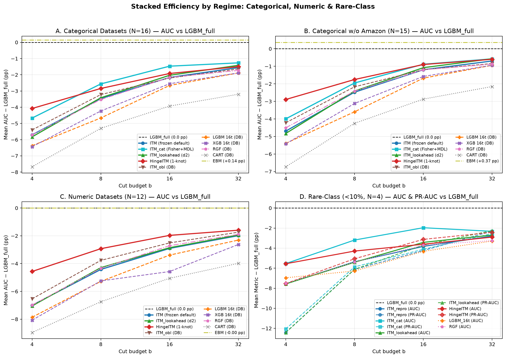

# Stacked Benchmark & Cost-Complexity Report (38 Datasets, 10k–1.66M Rows)

This note summarizes the extended evaluation of `bettertrees` v0.3.0 across **38 binary
classification datasets** from OpenML/TabArena and Kaggle:

- **10k–100k tier (28 datasets × 3 official splits = 84 splits)**: 16 categorical + 12 numeric
  datasets, evaluated at cut budgets `b ∈ {4, 8, 16, 32}`.
- **Large-scale tier (>100k rows, 10 datasets, 110k to 1.66M rows)**: 6 categorical + 4 numeric
  datasets (including `creditcard` 0.17% fraud, `BAF_base` 1.00M × 31, and `ACSIncome`
  1.66M × 11), with exact test-row predictions for both ROC-AUC and PR-AUC.

All comparisons against `InterleavedTreeClassifier` (`ITM`) and budgeted rivals (`LightGBM`,
`XGBoost`, `RGF`, `CART`, `EBM`, `LogReg_WoE`) use identical splits and `0.000e+00` verified
alignment (`max |ΔLL| = 0`, `max |ΔAUC| = 0`). Reference ceiling (`0.0 pp`) is unconstrained
`LGBM_full` (`num_leaves=31`, early stopping, ~6,300–8,500 cuts).

---

## 1. Large-Scale PR-AUC & 4-Core Speed (10 Datasets, 110k–1.66M Rows)

At **16 cuts** across the 10 large datasets (exact PR-AUC from held-out predictions):

| Method | Mean AUC | Mean PR-AUC | ΔPR vs ITM | W/T/L AUC vs ITM | Mean 4-core fit |
|---|---:|---:|---:|:---:|---:|
| **`InterleavedTreeClassifier` (no tuning)** | `0.8084` | **`0.5217`** | `0.00 pp` | — | **`2.38 s`** |
| `RGF` (tuned) | `0.8099` | `0.5161` | `-0.56 pp` | `6 / 0 / 4` | `106.8 s` (`45×`) |
| `XGBoost` (100 trials) | `0.8042` | `0.5078` | `-1.39 pp` | `0 / 0 / 10` | `33.4 s` (`14×`) |
| `LightGBM` (100 trials) | `0.8030` | `0.5082` | `-1.35 pp` | `1 / 0 / 9` | `36.4 s` (`15×`) |
| `CART` (tuned) | `0.7748` | `0.4788` | `-4.29 pp` | `0 / 0 / 10` | — |

**Million-row 4-core wall-clock times at 16 cuts** (pure Python + Numba `best_leaf_cuts_T`):

- **`BAF_base` (1,000,000 × 31, 1.1% fraud)**: `ITM` **5.34 s** fit / **85 ms** predict
  (`CategoricalInterleavedTreeClassifier`: 6.11 s / 118 ms) vs `LGBM_full` 8.13 s / 544 ms.
- **`ACSIncome` (1,664,500 × 11, numeric)**: `ITM` **4.36 s** fit / **70 ms** predict vs
  `LGBM_full` 24.46 s / 2,263 ms (**32× faster inference**).

---

## 2. 10k–100k Stacked Efficiency (28 Datasets × 3 Splits = 84 Splits)

At **16 cuts** on the 10k–50k tier (`N = 21`, where 100-trial boosting controls are available):

| Method | Mean AUC | Gap vs `LGBM_full` | Avg Rank AUC | Avg Rank LL |
|---|---:|---:|---:|---:|
| `EBM` *(unbudgeted)* | `0.8623` | `+0.08 pp` | `1.33` | `1.38` |
| `CategoricalInterleavedTreeClassifier` | `0.8397` | `-2.36 pp` | `5.81` | `5.05` |
| `HingeFIGSClassifier` *(experimental)* | `0.8386` | `-2.47 pp` | `3.71` | `4.33` |
| `ObliqueFIGSClassifier` *(experimental)* | `0.8374` | `-2.59 pp` | `5.33` | `5.00` |
| `RGF` (tuned) | `0.8366` | `-2.67 pp` | `5.05` | `5.38` |
| **`InterleavedTreeClassifier` (no tuning)** | **`0.8354`** | **`-2.79 pp`** | `6.71` | `6.43` |
| `XGBoost` (100 trials) | `0.8324` | `-3.09 pp` | `8.38` | `8.29` |
| `LightGBM` (100 trials) | `0.8322` | `-3.11 pp` | `9.14` | `8.71` |
| `CART` (tuned) | `0.8175` | `-4.58 pp` | `13.10` | `11.62` |

---

## 3. Honest Cost-Complexity Audit of Extensions

Per-cut rankings (`b`) alone can overstate extensions that pack more degrees of freedom into
each split. Auditing every extension under strict complexity accounting yielded clear placement
decisions for v0.3.0:

1. **`CategoricalInterleavedTreeClassifier` (Core — tabular usability & readability)**:
   - On nominal categorical datasets (`N = 15` excluding `amazon_employee_access` at `b = 16`):
     `+0.32 pp` AUC (`p = 0.0052`), `+0.66 pp` PR-AUC, `14/1/0` log-loss wins (`p = 1.2e-4`),
     and `0.000` noise-ID hijack rate across 10/10 high-cardinality adversarial seeds (thanks to
     `min_cat_weight=10` pooling and `2 ln(2) max(0, K_eff - 2)` MDL regularization).
   - **Important caveat**: unconstrained subset splits (`x ∈ S`) carry more descriptive bits
     than numeric cuts on high-cardinality columns. Passing `max_subset_size=3` keeps rules
     short (`+0.31 pp` AUC at `b = 16` without Amazon, `+0.92 pp` PR-AUC on `>100k`), and
     `min_cat_coverage=0.5` prevents collapsing near-unique ISO-8601 timestamps (such as
     `ScheduledDay` in `Medical-Appointment-No-Shows`) into `other`.
2. **`HingeFIGSClassifier` (`bettertrees.experimental` — piecewise-linear family)**:
   - Strong per-term on `10k–100k` numeric datasets (`12/0/0` AUC wins at `b ∈ {4, 8, 16, 32}`).
   - Under strict parameter accounting (`2 cuts` per bilateral hinge, `2·cuts + 4·hinges`), it
     retains `+0.36 pp` AUC on `10k–100k` numerics at `P = 32`, but trails `ITM` slightly on
     `>100k` (`-0.24` to `-0.38 pp`) and is neutral when enforced inside greedy search
     (`hinge_cost=2`). Kept in `bettertrees.experimental` as an opt-in continuous family.
3. **`LookaheadFIGSClassifier` (`bettertrees.lab` — research archive)**:
   - Same final model complexity as `ITM`, with only `+0.10 pp` AUC at `b ∈ {16, 32}` for
     `3–4×` slower fitting. Kept in `bettertrees.lab`.
